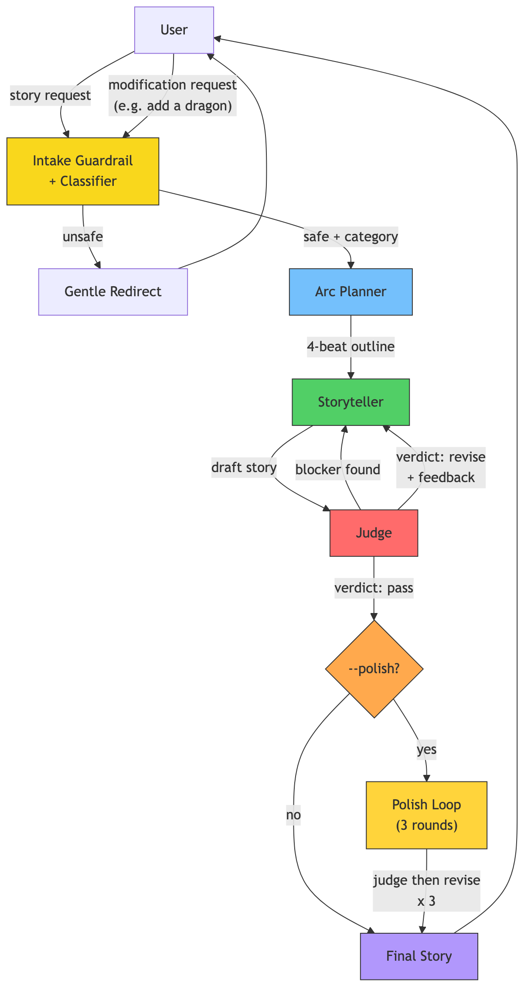

# Bedtime Story Generator

A generate→judge→revise pipeline that creates safe, calming bedtime stories for children ages 5–10 using gpt-3.5-turbo.

## Quick Start

```bash
# 1. Install dependencies
pip install -r requirements.txt

# 2. Set your API key
cp .env.example .env
# Edit .env and paste your OpenAI API key

# 3. Run
python main.py

# 3b. Run with polish mode (3 extra refinement rounds after passing)
python main.py --polish
```

## Design Rationale

### Why this architecture?

A bedtime story is a **sleep aid** read aloud by a tired parent, not a thriller. The entire system is designed around three principles:

1. **Safety first ("do no harm")**: Nothing scary, violent, sad-without-resolution, or age-inappropriate ever reaches the child. This is enforced as a hard gate at two levels, the intake guardrail rejects unsafe *requests*, and the judge's blocker tier catches unsafe *outputs*.

2. **Calming ("descending") arc**: Stories follow a 4-beat structure where emotional energy *decreases* in the final third. The arc planner explicitly avoids high-tension climaxes and builds in a drowsy wind-down.

3. **Read-aloud quality**: Short sentences (≤12 words), simple vocabulary, gentle rhythm, and a recurring soothing refrain the child can anticipate. The final line bridges to the child's own sleep.

### Why separate agents instead of one mega-prompt?

- **Temperature per stage**: Classification needs determinism (0), storytelling needs creativity (0.8), judging needs strict JSON (0). A single prompt can't serve all three.
- **Isolation**: A bad classification doesn't poison the story draft. A parse failure in the judge doesn't crash the pipeline.
- **Debuggability**: Each stage is logged with clear labels, so during a demo (or debugging) you can see exactly where the pipeline made its decisions.

### The judge's two-tier design

A single quality score could mask a safety failure (4.5 overall but contains a death scene). So:

- **Tier 1 — Hard blockers** (violence, unresolved fear, death/grief, inappropriate content, reading level): any `true` value means the story is **unsafe** and gets regenerated from scratch. We never try to "patch" unsafe content.
- **Tier 2 — Soft rubric** (safety, age-appropriateness, bedtime calmness, narrative arc, read-aloud quality, warmth): scored 1–5 each, averaged for an overall score. Below 4.3 → targeted revision with specific feedback.

### Control loop logic

- **Blocker** → full regeneration (stricter constraints on retry)
- **Low score** → revision with the judge's specific feedback
- **Best-of-N tracking** → we always keep the highest-scoring draft seen; if we hit MAX_ITERS=3 without a "pass", we return the best version, never a worse one
- **JSON parse safety** → strip markdown fences, try/except, retry once, then default to "revise"

### Polish mode (`--polish`)

Even when a story passes the judge on the first try, "passing" only means it cleared the minimum bar (4.3). The `--polish` flag forces 3 additional judge→revise cycles to push quality higher — sharpening read-aloud rhythm, deepening sensory imagery, and making the wind-down drowsier. Each round is monotonic: the polished version is only kept if it scores at least as well as the previous best and introduces no blockers, so polish can never make the output worse.

### Interactive feedback

After the final story, the user can request changes ("make it shorter", "add a dragon"). The modification re-enters the full pipeline carrying the prior story as context, so it gets the same safety and quality checks.

## System Architecture



## File Structure

| File | Purpose |
|---|---|
| `main.py` | Orchestrator, `call_model()`, control loop, interactive feedback |
| `agents.py` | Agent prompts + functions: intake, planner, storyteller, revision |
| `judge.py` | Two-tier judge: blockers + rubric, JSON parsing with fallback |
| `requirements.txt` | `openai>=1.0`, `python-dotenv` |
| `.env.example` | API key placeholder |
| `.gitignore` | Excludes `.env`, `__pycache__/`, etc. |

## Pipeline Stages (visible in console logs)

```
STAGE 1: Intake Guardrail + Classifier → safe=True, category=animal_friend
STAGE 2: Arc Planner                   → 4 beats, refrain, moral
STAGE 3: Storyteller (initial draft)   → 420 chars
STAGE 4: Judge (iteration 1/3)         → overall=4.5, verdict=pass ✅
```

With `--polish`, additional stages are logged:

```
POLISH MODE — 3 forced improvement rounds
  Polish round 1/3  → score before: 4.5, after: 4.7 ✅ kept
  Polish round 2/3  → score before: 4.7, after: 4.8 ✅ kept
  Polish round 3/3  → score before: 4.8, after: 4.8 ✅ kept
Polish complete — final score: 4.8
```

## If I Had 2 More Hours

1. **Fine-tuned reading-level scorer** — Replace the LLM-based reading-level blocker with a lightweight classifier (e.g., distilBERT fine-tuned on leveled-reader corpora). Faster, cheaper, and more accurate than asking gpt-3.5 to self-assess vocabulary complexity.

2. A multi-judge consensus system that runs the judge agent 3 times
per evaluation and takes the median scores, reducing single-call scoring variance that can cause good stories to be needlessly revised or borderline stories to slip through paired with deterministic readability metrics (Flesch-Kincaid grade level, average sentence length) as hard-coded guardrails that don't depend on LLM judgment at all.
